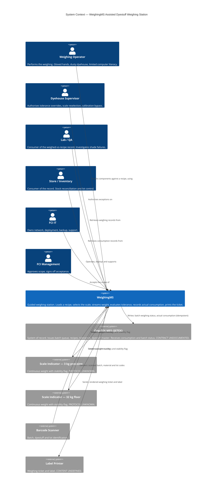
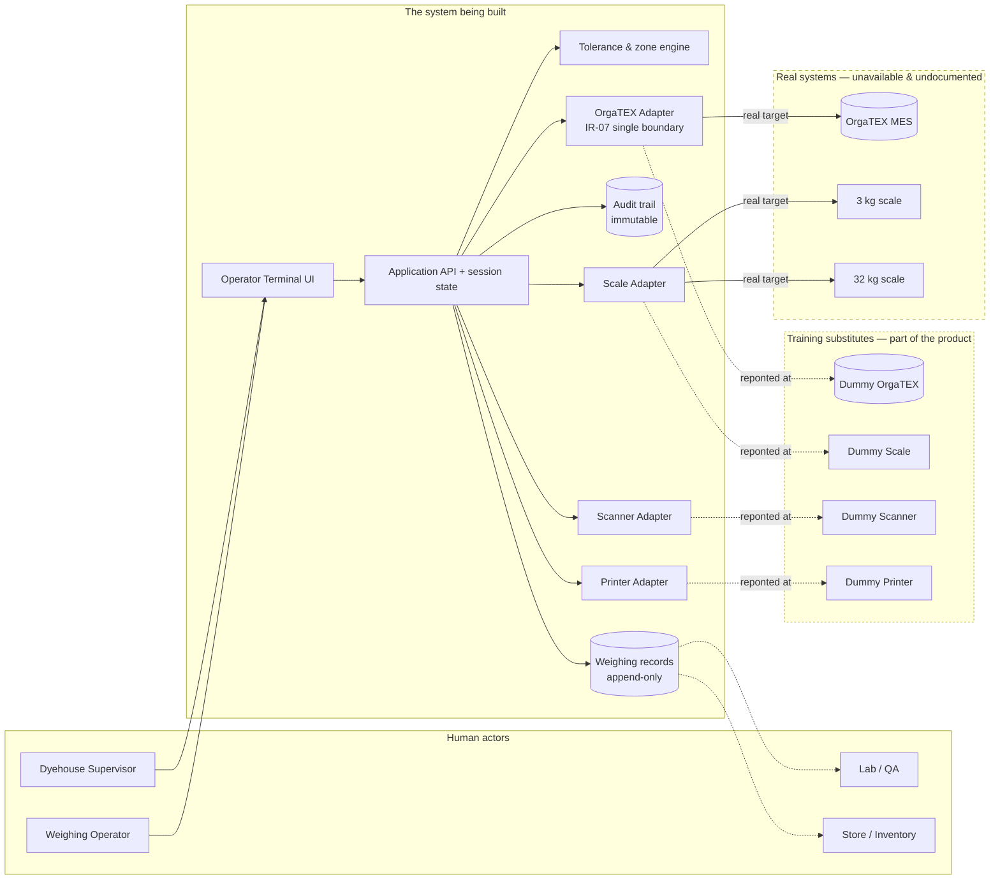

# Assisted Dyestuff Weighing Station - System Context

## System Overview

WeighingMS is a **single-station operator terminal application** that guides a
dyehouse operator through dispensing dyestuffs and dry auxiliaries for one dye
batch, against a recipe issued by FCI's OrgaTEX MES.

Its job is narrow and specific: **turn a recipe into a sequence of guided
weighing actions, and turn the resulting weighing into a recorded fact.** It
dispenses nothing by itself, it does not author recipes, and it does not
replace OrgaTEX — OrgaTEX remains the system of record for everything except
the weighing result.

The system sits at a physical boundary in a dyehouse: it reads from physical
instruments (scales, a barcode scanner, a label printer), it presents a
touch-screen terminal to a human wearing gloves, and it exchanges data with a
MES that is not under our control.

**The single most important boundary fact.** Three of the four external
dependencies — OrgaTEX, the scales, and the operator identity source — are
**not available in this build and their contracts are not documented**. They
are represented by four Dummy APIs that are *part of the product*, not test
fixtures. Every statement below about an external system describes a
**boundary and a direction of data flow**, never a claimed contract. The
shape of each real contract remains an open question (Q-01…Q-05) and is
owned by FCI, not by us.

### What WeighingMS owns

| Owned | Not owned |
|---|---|
| The weighing session and its state machine | Batches, orders, machines, recipes, tolerances, dyestuff master |
| The tolerance evaluation and the zone judgement | The dye batch and its lifecycle |
| The recorded weighing fact (actual weight, operator, scale, lot, timestamp) | Shade approval and re-dye decisions |
| The ticket/label rendering and the print job | The dyehouse schedule and the queue of work |
| The record of what was actually dispensed | The dispensing act itself — done by hand |

---

## Actors

### Human actors

- **Weighing operator** *(Human — primary)*: The daily user of the station.
  Performs the weighing: selects a batch, identifies the dyestuff, dispenses
  by hand, and confirms each component. Works wearing gloves, in a dusty and
  humid environment, and may have limited computer literacy (BRD C-05).
  WeighingMS must never let them bypass a tolerance failure by accident.

- **Dyehouse supervisor** *(Human — privileged)*: Authorises exceptions.
  Approves tolerance overrides, manual scale reselection and calibration
  bypass. Does not normally weigh. Authenticates for privileged actions
  (BRD NFR-12); credentials are never shared between roles.

- **Lab / QA** *(Human — consumer of the record, not a user)*: Retrieves the
  weighed-vs-recipe record to investigate a shade failure. Needs to
  distinguish a bad recipe from a bad weighing — this is the whole point of
  the product.

- **Store / inventory** *(Human — consumer of the record)*: Uses actual
  consumption for stock reconciliation and lot control. Not a user of the
  terminal.

- **FCI IT** *(Human — owner of the operating environment)*: Owns network,
  deployment, backup and supportability. Provides OrgaTEX network access and
  credentials (D-03). Does not use the station.

- **FCI management** *(Human — approver)*: Approves scope and signs off
  acceptance. Not a user of the terminal.

### System actors

- **OrgaTEX MES** *(System — upstream and downstream)*: The system of record.
  Issues the batch queue, the recipe and the tolerances; receives actual
  consumption and batch weighing status. Owned by SETEX, a third party.
  Read-only from WeighingMS except for those two writes.

- **Scale indicators** *(System / device — 2 instances)*: The 3 kg precision
  scale and the 32 kg floor scale. Stream weight continuously with a
  stability flag. WeighingMS selects between them automatically.

- **Barcode scanner** *(Device)*: Reads batch cards, dyestuff identities and
  lot codes. A 21-key terminal duplicates the touchscreen actions as a
  fallback (A-10).

- **Label printer** *(Device)*: Prints the weighing ticket and label.

- **Operator identity source** *(System — undecided)*: Supplies operator
  identity for traceability and supervisor authentication. FCI's own
  directory is an open question (Q-08) — this boundary is deliberately
  drawn but its implementation is not yet decided.

### Actors that are explicitly *not* in scope

- **Dispensing machinery** — no connection to, no control of (BRD C-03).
- **The dyeing machine (JET-04, WINCH-01)** — referenced as context in the
  breadcrumb and the ticket, but never called.
- **A worker carrying the container to the machine** — the process stays
  manual by design; the product deliberately does not automate dispensing.

---

## External Systems

Each entry states **what crosses the boundary** and **which direction**. Where
a real contract is undocumented, the entry says so explicitly.

| System | Purpose | Direction | Data crossed | Protocol | Contract status |
|---|---|---|---|---|---|
| **OrgaTEX MES** | Batch queue, recipes, tolerances, dyestuff master; receives consumption | **Both** | Inbound: released batches (id, order, machine, fabric/lot, shade, component count, status); recipes (components: material code, name, target, unit, tolerance, lot, container, tare) and tolerances. Outbound: batch weighing status; actual consumption per component | REST/JSON — **assumed shape, not confirmed** | ⚠️ **Undocumented.** A-01/A-02 assume a documented licensed REST API and that consumption postings are accepted. Q-01/Q-02 ask exactly this. All OrgaTEX interaction is confined to one adapter (C-13, IR-07) so the contract can change without touching the domain |
| **Scale indicator (3 kg)** | Precision weighing of dyestuffs | **Inbound** | Continuous weight readings with a stability flag; tare commands outbound | Device protocol — **unknown** (Q-03) | ⚠️ **Undocumented.** A-05 assumes continuous streaming at ≥10 Hz. If only a stabilised value exists, the live readout is not buildable as drawn |
| **Scale indicator (32 kg)** | Floor-scale weighing of auxiliaries | **Inbound** | Same as above | Device protocol — **unknown** | ⚠️ As above. Physical capacity bounds what can be weighed (C-06) |
| **Barcode scanner** | Batch, dyestuff and lot identification | **Inbound** | Barcode payload; entity type and value | Keyboard-wedge / USB — **assumed** | ⚠️ A-10 assumes dyestuffs carry scannable barcodes (Q-07). Falls back to operator attestation if not |
| **Label printer** | Weighing ticket and label | **Outbound** | Rendered ticket / label content and print job | Printer language — **deliberately not invented** | ⚠️ The prototype states *"Label content is invented"*. Q-11 asks what the ticket must carry. The ticket layout in the prototype is a training artefact, not a contract |
| **Operator identity source** | Operator identity and supervisor authentication | **Inbound** | Operator identity, role, authentication result | Undecided | ⚠️ Q-08 asks whether FCI supplies its own directory. A-09 assumes per-operator traceability is required |

### Training substitutes (part of the product)

Because the six systems above are unavailable, four **Dummy APIs** stand in for
four of them. They are a product surface — independently exercisable, and
documented as training contracts.

| Dummy | Stands in for | Boundary position |
|---|---|---|
| **Dummy OrgaTEX** | OrgaTEX MES | Behind the adapter boundary. The adapter is the *only* thing that knows which it is talking to |
| **Dummy Scale** | Both scale indicators | Behind the scale-adapter boundary |
| **Dummy Scanner** | Barcode scanner | Behind the scanner-adapter boundary |
| **Dummy Printer** | Label printer | Behind the printer-adapter boundary |

**The operator identity source has no dummy.** It is a *local* concern of the
station (sign-in, role, session), not an external integration — so it belongs
inside WeighingMS and is not faked as an external service.

**The rule that governs all four.** A Dummy may only be reached through the
adapter boundary that would hold the real system. The adapter is written
against a *contract*; the Dummy implements that contract. When the real
contract arrives, the adapter is repointed and nothing above it changes. This
is the mechanism by which Rule 5 of the workbook ("dummy integrations are real
development artifacts") is satisfied without inventing a real API.

---

## Data Flows

### Inbound

| Flow | From | Data | Format | Validation at the boundary |
|---|---|---|---|---|
| **I-1 Batch queue** | OrgaTEX | Batch id, order ref, machine ref, fabric/lot, shade, component count, weighing status | JSON | Schema-validated; batches not in `RELEASED` are displayed but not selectable, with the reason shown |
| **I-2 Recipe** | OrgaTEX | Per component: material code, name, target quantity, unit, tolerance, lot, container id, tare | JSON | Schema-validated; tolerance present and > 0; unit in {g, kg}; target > 0 |
| **I-3 Weight stream** | Scale indicator | Weight value (fixed-point decimal), stability flag, scale id, sequence number | SSE, 10 Hz | Value is decimal text, never a float; sequence gaps mark a reconnect |
| **I-4 Scan payload** | Scanner | Barcode string, entity type | JSON | Entity type known; code resolves to a known batch, material or lot |
| **I-5 Operator identity** | Local identity store | Operator id, name, role, authentication result | — | Role must exist; session is time-boxed |
| **I-6 Configuration** | Local config (FCI-managed) | Scale thresholds, tolerance overrides, label template, locale, calibration state | JSON | Validated at load; invalid values block the affected action rather than being silently ignored |

### Outbound

| Flow | To | Data | Format | Guarantee |
|---|---|---|---|---|
| **O-1 Consumption posting** | OrgaTEX | Batch id, per-component actual quantity, unit, lot, operator id, timestamp, weighing record id | JSON | **Idempotent** (IR-08) — replaying the same posting does not double-count. Retried on failure; queued while offline |
| **O-2 Batch weighing status** | OrgaTEX | Batch id, status (`IN_PROGRESS`, `WEIGHED`, `HELD`) | JSON | Idempotent; last-writer-wins on status |
| **O-3 Ticket / label** | Printer | Rendered ticket content | Rendered payload | A print job is recorded and retryable; a reprint is marked as a reprint |
| **O-4 Tare command** | Scale indicator | Tare request for the selected scale | Device-specific | Sent on scale selection and on explicit re-tare |
| **O-5 Audit record** | Internal store | Privileged action, actor, reason, timestamp, prior state | Append-only | **Immutable** (DR-02); exportable (NFR-13); retained ≥ 5 years (DR-01) |
| **O-6 Weighing record** | Internal store | Target, actual, operator, scale, lot, container, timestamp, zone at confirm | Append-only | Fixed-point decimal throughout; immutable once confirmed |

### Internal (not a boundary, but load-bearing)

- **Weight → zone evaluation.** Every inbound reading is evaluated against the
  active component's target and tolerance to produce one of four zones
  (`under` / `near` / `ok` / `over`). This is the pivot of the entire product
  and it is *internal* logic, not an integration.
- **Session state.** Which batch, which component, which zone, what has been
  dispensed. Resumable at the component in progress after an interruption
  (NFR-06).

---

## Context Diagram

### Boundary view — what is real, what is a dummy, what is out of scope

---

## Integration Boundaries and Failure Boundaries

These are the places where the system can break, and what happens on each side
of the break.

| # | Boundary | Failure mode | System behaviour | Requirement |
|---|---|---|---|---|
| **B-1** | OrgaTEX adapter → OrgaTEX | OrgaTEX unreachable, slow or erroring | Weighing **continues**. Consumption postings queue locally and retry. Queue depth and age are visible. Sync must not duplicate (idempotency key). | FR-20, NFR-3, IR-08 |
| **B-2** | OrgaTEX adapter → OrgaTEX | Contract shape differs from assumption | The adapter is the single point of change (C-13). Nothing above it depends on the external shape. | FR-16, C-13, IR-07 |
| **B-3** | Scale adapter → scale indicator | Stream drops or the scale stops responding | Disconnect detected and weighing **blocked** within 2 s. The operator is told which scale failed and what to do. The stream reconnects automatically. | FR-19, IR-13, NFR-1 |
| **B-4** | Scale adapter → scale indicator | Scale is out of calibration | Weighing is prevented on that scale until calibration is confirmed current. | AC-14, NFR-6 |
| **B-5** | Scale adapter → scale indicator | Scale returns only a stabilised value, not a stream | Guided dispensing as drawn is not buildable. **This is the single largest design risk** — it changes the interaction's shape, not its pixels. | FR-8, A-05, Q-03 |
| **B-6** | Scanner adapter → scanner | Code unreadable or unknown | Fall back to manual selection/attestation; the fallback is recorded, so an unattested weighing is distinguishable in the audit trail. | FR-4, A-10, Q-07 |
| **B-7** | Printer adapter → printer | Printer offline or out of paper | The weighing record is already durable; printing fails without losing the weighing. Retryable print job; reprint is marked as a reprint. | FR-17, FR-19 |
| **B-8** | UI → API | Network fault between terminal and API | The terminal shows an explicit degraded state rather than stale numbers. The weight readout is never presented as live when the stream is not live. | FR-8, NFR-1 |
| **B-9** | Internal → storage | Power loss mid-session | A confirmed weighing survives immediate power loss. An interrupted session is resumable at the component in progress. | NFR-3 (NFR-05, NFR-06) |
| **B-10** | Identity → session | Supervisor override attempted without valid authentication | The override is refused and the attempt is audited. No credential sharing (NFR-12). | FR-13, FR-21 |
| **B-11** | Local → OrgaTEX (write-back) | Consumption posted twice, or posted after a manual OrgaTEX edit | Posting is idempotent against a stable record id; a second posting of the same record id is a no-op, not a double count. | IR-08, C-14 |

### Failure-boundary rule

**No failure at any boundary may produce a silently wrong number.** A weight
that is not live is shown as not live. A consumption posting that has not
landed is shown as pending, not as confirmed. A weighing that was never
recorded is never shown as recorded. The prototype's `ORGATEX · LINKED` status
is a hard-coded string; in the built system it reflects a real link state and
reads `LINKED`, `DEGRADED` or `OFFLINE`.

---

## High-Level Constraints

### Technical constraints

- **All OrgaTEX interaction is confined to a single adapter component.** *(BRD IR-07, C-13)*
- **Consumption posting is idempotent.** *(BRD IR-08, C-14)*
- **Confirmed records are immutable; a correction is a new record referencing the original.** *(BRD DR-02)*
- **No floating point for quantities** — in API payloads, in persistence, and in the UI. Fixed-point decimal, 4 dp in storage, 1 dp for grams and 3 dp for kilograms on display. *(BRD NFR-16, PROTO `dp()`)*
- **The Dummy APIs are training contracts only** and are reached only through the adapter boundary. No real external contract is invented or asserted. *(Workbook section 0; C-13)*
- Project-wide standards are loaded from `memory-bank/standards/` — see `tech-stack.md` for the approved stack and service topology.

### Business constraints

- **OrgaTEX remains the single source of truth** for batches and recipes. *(BRD C-01)*
- **No modification to OrgaTEX.** *(BRD C-02)*
- **No connection to or control of dispensing machinery.** *(BRD C-03)*
- **Industrial dyehouse environment** — dust, humidity, cleaning. *(BRD C-04)*
- **Operators may have limited computer literacy.** *(BRD C-05)*
- **Physical scale capacities bound what can be weighed.** *(BRD C-06)*
- **All primary actions reachable with gloved hands, ≥ 15 mm touch targets.** *(BRD NFR-07)*
- **The interface exposes exactly three views** — Select batch, Weigh, Confirm & print. *(C-03)*
- **WeighingMS does not automate dispensing.** The operator still dispenses by hand and a worker still carries the container to the machine. *(Intent Overview)*

---

## Key NFR Goals

| Goal | Target | Boundary it constrains |
|---|---|---|
| **Weight display lag** | ≤ 200 ms end-to-end | B-3, B-5, B-8 — the scale stream and the terminal path |
| **Scale sampling rate** | ≥ 10 Hz | B-3 — the scale adapter's transport |
| **Batch selection → recipe displayed** | ≤ 3 s when online | B-1, B-2 — the OrgaTEX adapter's latency budget |
| **Scale disconnect detection** | ≤ 2 s, then block weighing | B-3 |
| **Station availability** | 99% in production hours; weighing available during an OrgaTEX outage | B-1 — offline queueing is a correctness requirement, not a nicety |
| **Power-loss durability** | A confirmed weighing survives immediate power loss | B-9 — write-ahead ordering on confirm |
| **Session recovery** | Resumable at the component in progress | B-9 |
| **Touch targets** | ≥ 15 mm on all primary actions | UI — constrains layout of every action row |
| **Readout legibility** | Readable at 1.5 m | UI — constrains readout type scale and contrast |
| **Operator competence** | Within one shift | UI — constrains density, wording, and use of physical gestures |
| **Hardware at the station** | IP54 minimum | The terminal's physical installation |
| **Privileged actions** | Supervisor authentication required; credentials never shared | B-10 |
| **Audit records** | Immutable and exportable | B-5, B-10 — every privileged action |
| **Record retention** | ≥ 5 years | Storage sizing for weighing and audit records |
| **Configuration changes** | No redeployment for scale, tolerance, label, language | I-6 — configuration is data, not code |
| **Station capacity** | FCI's actual daily volume without degradation | Whole-system — volume is an open question (Q-09) |
| **Operator-facing text** | Fully externalised for translation | UI — no hard-coded strings |

---

## Scope Boundaries of This Context

**Deliberately excluded from the context diagram** (and why):

- **Dispensing machinery** — explicitly out of scope (BRD C-03). Excluding it
  is a constraint, not an omission.
- **The dyeing machine** — appears in the breadcrumb and the ticket as data,
  but WeighingMS never calls it.
- **Shade approval and re-dye decisions** — belong to Lab/QA and to OrgaTEX.
  WeighingMS supplies the evidence; it does not make the call.
- **A multi-station fleet** — the BRD describes one station. Capacity for more
  is a deployment concern, not a different context.

**Deliberately included, though its contract is unknown:**

- **The operator identity source.** It is drawn as a boundary because
  per-operator traceability is a confirmed goal and supervisor authentication
  is a hard NFR. Drawing the boundary now keeps the option of an FCI directory
  open; deciding the implementation is Q-08's job, not this document's.

---

## Open Questions Raised by the Context Work

These arise from drawing the boundaries, not from reading the BRD. They are
**additional** to the twelve in `requirements.md` (Q-01…Q-12) and to the
eighteen in `ui-analysis.md` (PQ-01…PQ-18). Each is recorded with an owner,
because an unowned open question is a hidden assumption.

| ID | Question | Owner | Affects |
|---|---|---|---|
| **CQ-01** | Where does the ticket get printed — at the station, or is it queued for a shared dyehouse printer? The prototype implies a local printer; the BRD does not say. | FCI | B-7, FR-17, O-3 |
| **CQ-02** | Is the operator's identity established once per shift or once per weighing? The prototype's topbar shows a single operator chip for the whole session, which implies per-shift. | FCI production | B-10, FR-18 |
| **CQ-03** | Does a batch have one weighing session, or can it be split across shifts / interrupted and resumed by a different operator? NFR-06 says sessions are resumable, but not by whom. | FCI production | FR-18, FR-20, NFR-3 |
| **CQ-04** | Does the 3 kg scale and the 32 kg scale belong to one physical indicator that is re-zeroed, or two separate devices? The prototype's status strip lists them as two separate statuses, which suggests two devices. | FCI | B-3, FR-7, O-4 |
| **CQ-05** | Is the consumption posting per batch, per component, or per component per lot? The recipe may draw one component from two lots, which changes the posting's shape. | FCI / SETEX | O-1, FR-16, A-02 |
| **CQ-06** | What happens to a weighing record when OrgaTEX *rejects* a posting — permanently failed, or retryable indefinitely? A permanent rejection needs a human path. | FCI / SETEX | B-1, B-11, FR-20 |
| **CQ-07** | Does the dyehouse need the weighing data for anything other than reconciliation and shade-failure investigation — e.g. a dashboard, or export to a BI tool? That would be a new outbound flow, not a new context. | FCI | O-1…O-6, FR-23 |
| **CQ-08** | Is there an existing barcode on the dyestuff containers that already identifies the lot, or must the operator key it in? This determines whether FR-5 is a scan or a form. | FCI production | I-4, B-6, FR-5 |

**Note on the numbering.** Three families now coexist and are deliberately kept
apart so each keeps its origin: `Q-nn` (BRD-sourced, in `requirements.md`),
`PQ-nn` (prototype-sourced, in `ui-analysis.md`), `CQ-nn` (context-sourced,
here). Merging them into one series would silently discard the provenance of
each question, and the whole point of tracking them separately is that a
different owner answers each family.

---

## Traceability

| Context element | Source |
|---|---|
| Actors (6 human, 5 system) | BRD §2, §5; requirements.md Primary User; PROTO topbar and status strip |
| OrgaTEX as upstream and downstream | BRD C-01, C-02, §9.2, IR-06…IR-09 |
| Scale indicators (2) | BRD §9.3, IR-10…IR-13; PROTO `c.scale`, status strip |
| Barcode scanner | BRD §9.4, §9.6; PROTO scan prompt |
| Label printer | BRD §9.5, IR-14; PROTO view 3 ticket |
| Operator identity source | BRD §9.6, NFR-12, A-09; Q-08 |
| Four Dummy APIs | requirements.md Training-Only Dummy Behaviour; workbook section 0 |
| Adapter boundary (IR-07) | BRD IR-07, C-13 |
| Idempotent posting (IR-08) | BRD IR-08, C-14 |
| Fixed-point decimal (NFR-16) | BRD NFR-16, §9.2; PROTO `dp()` |
| Immutability (DR-02) | BRD DR-02, NFR-13 |
| Retention ≥ 5 years (DR-01) | BRD DR-01 |
| Three views only | C-03; PROTO |
| NFR goals table | BRD NFR-01…NFR-16 |
| Business constraints | BRD C-01…C-06 |
| Dependencies D-01…D-07 | requirements.md Dependencies |
